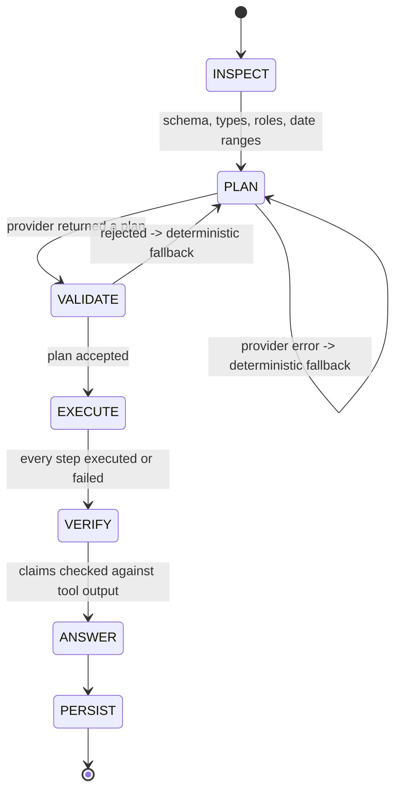
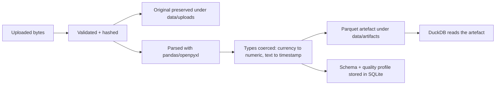

# Architecture

This document describes how the system is put together and, more importantly, *why* the
boundaries are where they are.

## 1. The core idea

A language model is good at turning a question into a sequence of intentions and bad at
doing arithmetic. The application therefore splits the job:

```
question  ──►  plan (tool + arguments)  ──►  validated execution  ──►  verified answer
   ▲                                                          │
   └──────────── the model never sees raw rows ───────────────┘
```

The model may only emit a **plan**: a list of `(tool, arguments)` pairs referring to a
closed registry. The plan is validated before execution. The numbers in the answer come
from the tool output, and they are checked against it.

## 2. Layers

| Layer | Package | Responsibility |
|---|---|---|
| API | `app/api` | HTTP concerns only: validation, status codes, streaming exports. |
| Agent | `app/agent` | The workflow, plan validation, numeric verification, narrative synthesis. |
| Tools | `app/tools` | The 19 allowlisted tools, chart validation, exporters. |
| Engine | `app/engine` | DuckDB execution and the trusted SQL templates. |
| Ingest | `app/ingest` | Safe readers, schema inference, quality analysis, dataset registry. |
| Domain | `app/domain` | API schemas, tool input models, the KPI catalogue. |
| Core | `app/core` | Configuration, logging, errors, money, periods, security, crypto. |
| Persistence | `app/db` | SQLAlchemy models and session management. |
| Providers | `app/providers` | Adapters for six model back-ends. |

Dependencies point downwards only: `api → agent → tools → engine → ingest → core`.

## 3. The agent workflow



### INSPECT
The agent loads the *authorised* datasets only. For each one it builds a compact
`DatasetContext`: column names, inferred types, semantic role hints, the date range of
every date column and the latest period. **No row values are sent to the model.**

### PLAN
A provider turns the question and the dataset contexts into a plan. The deterministic
`free` provider does this with a documented rule set; hosted providers are asked for
strict JSON.

### VALIDATE
`app/agent/planner.py` enforces the security contract:

* the tool exists in the registry,
* the arguments satisfy the tool's strict schema (`extra="forbid"`),
* every referenced dataset is authorised for this request,
* the plan is not longer than the configured budget,
* no argument key looks like code, SQL, a path or a URL.

A rejected plan falls back to the deterministic provider rather than failing the
request.

### EXECUTE
`app/tools/base.py` dispatches each step:

1. validate the arguments,
2. check the dataset scope,
3. run the handler in a worker thread with a timeout,
4. bound the result size and row count,
5. record the call in the trace.

A failing step is recorded, not fatal: the trace shows exactly which step failed and
why, and the answer says so.

### VERIFY
When a hosted model writes the narrative, every number in it is extracted and matched
against the tool output (verbatim or within a 0.5 % tolerance). Unverified numbers are
reported to the UI and flagged in the answer. The deterministic narrative is generated
*from* the tool output, so it is grounded by construction.

### ANSWER & PERSIST
The narrative, the plan, the tool trace, the evidence block and the reproducibility
metadata are written to `analysis_records` and to the conversation.

## 4. The query engine

All analytics run in DuckDB over a normalised Parquet artefact.

* **Values are always bound parameters.** A filter value such as
  `'; DROP TABLE datasets; --` is a string, never SQL.
* **Identifiers are allow-listed.** A column name is checked against the dataset's own
  column list and then double-quoted. Anything else is rejected.
* **Money uses `DECIMAL(18,4)`.** Sums of thousands of rows do not accumulate binary
  floating-point drift; the presentation layer rounds to two decimals.
* **Time buckets are calendar buckets.** `date_trunc`/`strftime` on the source dates.
  No implicit timezone conversion is applied, so "2024-05" means what the file says.
* **Zero denominators are explicit.** A percentage change from zero is reported as
  *undefined* with a note, never as infinity or zero.

## 5. Data lifecycle



* The original file is never modified; its SHA-256 hash identifies the exact bytes.
* The artefact is a deterministic projection used by the query engine.
* Re-importing identical content creates a new *version* of the same lineage instead of
  a duplicate.
* Deleting a dataset removes the file, the artefact and the metadata rows.

## 6. Providers

| Adapter | Protocol | Notes |
|---|---|---|
| `free` | none | Deterministic intent → plan mapping. No network, no tokens. |
| `openai` | `/chat/completions` | `response_format: json_object`. |
| `openrouter` | `/chat/completions` | Same dialect, extra attribution headers. |
| `custom` | `/chat/completions` | Any compatible endpoint. |
| `ollama` | `/v1/chat/completions` | The OpenAI-compatible surface of a local Ollama. |
| `anthropic` | `/v1/messages` | JSON extracted from a fenced block and validated. |

Every adapter returns the same `ProviderResult`, so the workflow does not care which
one is in use. A provider failure is caught, logged and replaced by the deterministic
fallback - the user still gets an answer.

## 7. Persistence

SQLite by default, PostgreSQL through `DATABASE_URL`.

| Table | Contents |
|---|---|
| `datasets` | Import metadata, hashes, versions, schema and quality profiles. |
| `dataset_versions` | The lineage of a dataset. |
| `dataset_columns` | Per-column metadata. |
| `conversations`, `messages` | The chat history. |
| `analysis_records` | The reproducible analysis: plan, trace, evidence, usage. |
| `saved_reports` | Pinned analyses with their chart. |
| `metric_definitions` | User-approved KPI → column mappings. |
| `approved_joins` | User-approved join relationships. |
| `business_calendars` | Work days, holidays and fiscal calendar. |
| `provider_configs` | Provider configuration; the key is encrypted. |
| `usage_records` | Token and cost accounting. |
| `audit_logs` | Every mutation. |

## 8. Security boundaries

| Threat | Control |
|---|---|
| Arbitrary code execution | The registry is closed; arguments are schema-validated with `extra="forbid"`; code-like keys are rejected. |
| SQL injection | Values are bound; identifiers are allow-listed and quoted. |
| Path traversal | File names are sanitised and resolved inside the managed directory. |
| Zip bombs | Expansion ratio and total uncompressed size are checked. |
| Prompt injection in data | Cell values and column names are data, never instructions; the detector is exercised by the test-suite. |
| Cross-dataset access | Per-request authorisation of dataset identifiers. |
| Unauthorised joins | A join key must be approved by the user. |
| Formula injection in exports | Formula triggers are escaped in CSV and XLSX. |
| Secret exposure | Keys are encrypted at rest and masked in the API. |
| Resource exhaustion | Upload size, row limits, result size, timeouts, plan length and cost budgets. |
